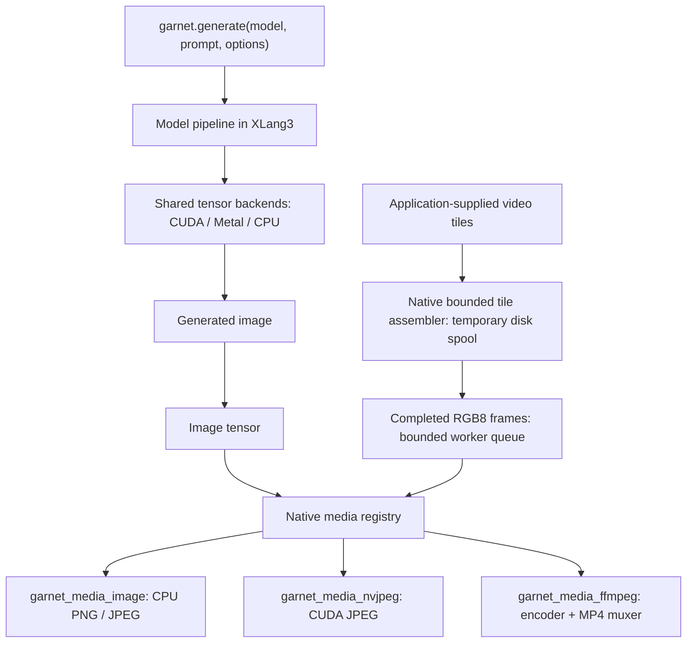

# Native media providers

Garnet schedules image generation and accepts frames from applications. Optional native libraries own image
codecs and MP4 encoding. Garnet never launches FFmpeg or calls CPython to produce
media. The `.py` model orchestration runs in XLang3 and calls these C++ bindings.



This separates model operations, hardware tensor operations and media codecs.
Only the generation model decides when pixels are final. Shared tensor operators
remain in the existing backend layers; FFmpeg and nvJPEG stay outside them.

## Source layout

| Location | Responsibility |
| --- | --- |
| `src/model/generation_api.h` | Native public prompt-to-file dispatch |
| `xModel/flux2/klein_4b` | Image model inference and VAE scheduling |
| `src/media/media_plugin_api.h` | Versioned C ABI and explicit frame descriptors |
| `src/media/media_registry.*` | Lazy loading, frame ownership, queue and tile assembly |
| `src/media/media_api.h` | XLang3 bindings to native media operations |
| `plugins/media_image` | PNG encoder, CPU PNG/JPEG decoding and JPEG encoding |
| `plugins/media_nvjpeg` | CUDA JPEG encoding |
| `plugins/media_ffmpeg` | FFmpeg codec selection, pixel conversion and MP4 muxing |
| `test/media` | Real codec, frame layout, queue, spool and optional-loading tests |

The FFmpeg provider adapts encoder selection and frame preparation from
`Lumen/WebRTC/video_encoder.cpp`; the CUDA JPEG provider adapts encoding from
`xWorld/src/image_proc/HwImageProcessor.cpp`. Neither application is linked or
required at runtime. This provider keeps encoded AVPackets intact for timestamp
rescaling and MP4 muxing, including delayed packets and end-of-stream drain.

## Loading and lifetime

The new media host adds only thread and platform dynamic-loader dependencies to
the core. FFmpeg, WIC, libjpeg, libpng and zlib for these outputs are isolated in
providers. The CUDA core already delay-loads nvJPEG for its existing image
preprocessing decoder; the new JPEG encoder is in the optional provider.
The host loads a provider only on the first request. The default location is
`<garnet-library-directory>/plugins/media/`; `GARNET_MEDIA_PLUGIN_DIR` overrides
that directory. Windows names are `garnet_media_image.dll`,
`garnet_media_nvjpeg.dll` and `garnet_media_ffmpeg.dll`. Unix names use the usual
`lib` prefix and `.so` or `.dylib` suffix.

The exported `GarnetMediaGetProviderV1` function returns the ABI version, structure
size, provider identity and function table. The host checks these before use.
Errors cross the boundary as return codes and caller-owned text buffers. Each
provider destroys its own objects. Loaded libraries stay resident until process
exit so live worker sessions never call unloaded code.

Frames specify RGB8/BGR8/RGBA8 or planar RGB FP32, dimensions, pitches, memory
device and logical device index. FP32 output maps [-1,1] to RGB8 with clamping and
ties-to-even rounding. NaN and infinity are rejected. CPU RGBA decoding composites
transparency over white. Images are limited to 16,384 pixels per side and
67,108,864 pixels total. Video uses even dimensions and integer frame rates 1–240.

A synchronous image call holds a tensor read lease until source reads complete.
The nvJPEG provider synchronizes its CUDA stream before returning. The video
worker owns its RGB8 byte vectors and never accesses XLang VM objects. A provider
must consume a submitted frame or retain its own copy before returning. Encoder
finish drains delayed packets, writes the MP4 trailer and closes the file.

## Bounded video assembly and overlap

Applications can submit overlapping planar FP32 tiles. The assembler
combines matching fragments, converts complete frames to RGB8, and submits
them to the encoder. It can spool earlier tiles to disk to limit host memory.

The queue defaults to two frames, blocks the producer when full and permits
1–16 queued frames. After submission/consumption, buffers are released for reuse.
`save_frames` defaults to false; optional PNG snapshots are for inspection.
With snapshots enabled, `snapshot_workers` selects 1–16 concurrent CPU encodes
(default 1). Values above 1 overlap bounded PNG tasks with ordered video
submission. Compression settings and PNG bytes are unchanged. `finish()` joins
every task and propagates snapshot errors. The writer retains at most
`queue_capacity + 2 + snapshot_workers` RGB8 input buffers in this mode;
`queue_max_pixel_bytes` reports that bound. This excludes provider-local
compression buffers and codec allocations.

Tile blending traverses contiguous rows while preserving each pixel's tile
addition order. Coverage validation precedes normalization. A temporary FP32
alpha tile is reported separately as `blend_workspace_peak_bytes` (1 MiB for a
512x512 tile); canvas and coverage retain their existing bound.

`finish()` waits for the worker and encoder drain. `abort()` closes an assembler
and removes its managed temporary files. Cleanup only removes files and an empty
directory created by that session; the supplied spool parent is retained.

For 1280×704 and 121 frames, canvas plus blending weights are bounded to **55 MiB**
instead of **1,663.75 MiB** for the full video. This excludes the current decoded
tile, one spool-read tile, model tensors and the RGB8 queue. The default queue's
upper bound including its producer and worker frames is another **10.3125 MiB**.
Temporary FP32 spool space grows with tile count and duration. This deliberately
trades temporary disk I/O for bounded host pixel memory without keeping every
tile's causal state in VRAM.

Model weights, denoising activations and VAE workspaces are unchanged. Video input
currently travels through CPU RGB8, CPU RGB-to-NV12 conversion and upload to the
selected hardware encoder. GPU video input is not yet a zero-copy path. The NVENC
pool starts at four surfaces; codec-owned buffering is additional to the host
queue. Parallel encoding therefore does not imply lower peak VRAM. GPU JPEG can
encode directly from a CUDA tensor, with a temporary RGB8 conversion for FP32.

## Build providers separately

All providers are standalone CMake projects. They can be built, installed or
omitted independently of the core. Point their output at the runtime's media
directory. For example, from a Visual Studio x64 developer shell:

```powershell
cmake -S <repo>/plugins/media_image -B <build>/media-image -G Ninja `
  -DCMAKE_BUILD_TYPE=Release -DGARNET_ZLIB_ROOT=<private-zlib-sdk> `
  -DGARNET_MEDIA_OUTPUT_DIRECTORY=<bin>/plugins/media
cmake --build <build>/media-image

cmake -S <repo>/plugins/media_ffmpeg -B <build>/media-ffmpeg -G Ninja `
  -DCMAKE_BUILD_TYPE=Release -DGARNET_FFMPEG_ROOT=<private-ffmpeg-sdk> `
  -DGARNET_MEDIA_OUTPUT_DIRECTORY=<bin>/plugins/media
cmake --build <build>/media-ffmpeg

cmake -S <repo>/plugins/media_nvjpeg -B <build>/media-nvjpeg -G Ninja `
  -DCMAKE_BUILD_TYPE=Release -DCMAKE_CUDA_ARCHITECTURES=<target-sm> `
  -DGARNET_MEDIA_OUTPUT_DIRECTORY=<bin>/plugins/media
cmake --build <build>/media-nvjpeg
```

On Windows, the image provider uses WIC and a private zlib SDK with
`include/zlib.h` and `lib/zlib.lib`. The FFmpeg SDK follows Lumen's static library
layout: `include/` plus `lib/avcodec.lib`, `avformat.lib`, `avutil.lib`,
`swscale.lib`, `swresample.lib`, `vpl.lib`, `libssl.lib`, `libcrypto.lib` and
`zlib.lib`. These projects use the static MSVC runtime to match that SDK. Keep SDK
headers and libraries outside the source tree. Install CUDA runtime/nvJPEG DLLs
with the nvJPEG provider, or make them available through normal DLL resolution.
Carry the selected SDK's license notices with redistributed binaries.

On non-Windows platforms the image provider finds ZLIB, JPEG and PNG through
CMake; the FFmpeg provider finds libavcodec/libavformat/libavutil/libswscale through
pkg-config. Those build paths require separate validation.

PNG is CPU encoded. CUDA JPEG uses nvJPEG. The FFmpeg provider reports compiled
encoders and probes actual availability by opening the encoder. `encoder="auto"`
tries hardware candidates and then software. An explicit encoder fails clearly
if unavailable. `allow_hardware=false` requests software. The tested Windows SDK
has no libx264; its CPU H.264 fallback is `h264_mf` with `hw_encoding=0`.
NVENC H.264 and Media Foundation CPU H.264 are validated on Windows. HEVC, AV1,
QSV, AMF, VAAPI and VideoToolbox need their own device qualification; some require
additional device/frame-pool setup. Candidate names are not a support guarantee.

## Native entrypoints

```python
import garnet
result = garnet.generate("flux2-klein-4b", "A red apple on a wooden table",
    checkpoint="CHECKPOINT", cache="CACHE", output="apple.png", seed=42)
```

These are XLang3 calls. The native dispatcher invokes the matching model pipeline;
the native media bindings invoke DLL function pointers directly. Applications can
also use `garnet.media().encode_image`, `decode_image`, `require_provider`,
`garnet.video_writer` and `garnet.video_assembler`. Lower-level constructors accept
a JSON options string; image encoding accepts a tensor, output path and JSON
options. Video `write_chunk` accepts contiguous FP32 `[1,3,F,H,W]` tensors.
`finish()` returns JSON metadata including the selected encoder and queue bounds.

To mux application-supplied audio, a session configured with
`audio_sample_rate` and `audio_channels` accepts one contiguous CPU FP32 PCM tensor
through `write_audio(tensor, sample_rate)` before any video frames. The optional
`GarnetMediaGetAudioProviderV1` extension encodes AAC and muxes both tracks. The
original image/video provider ABI remains unchanged. Audio buffers are consumed
synchronously under a read lease; this path adds no speech synthesis dependency.

The optional `GarnetMediaGetInputProviderV1` extension decodes audio and resamples
it to planar stereo PCM through libavcodec/libswresample. Mono is duplicated at
unity gain. Codec input is limited to mono/stereo and 600 seconds, with finite
sample checks. Core calls `media.decode_audio(path, rate)` directly through the
DLL function table; production never launches FFmpeg. Native helpers provide
cropped/padded PCM segments, center-cropped bilinear image resizing, and a generic
Slaney log-mel frontend (magnitude FFT, periodic Hann, centered reflect padding).
The video assembler also accepts an entire tile through
`video_assembler.add_tile(index, tensor)` and splits it into bounded chunks.

## Validation

Configure the core with `GARNET_TEST_MEDIA=ON` and
`GARNET_FFPROBE_EXECUTABLE=<ffprobe>` after installing providers. Set
`GARNET_TEST_MEDIA_CUDA=ON` to include nvJPEG and NVENC checks, and select the
test GPU in the environment. Run `ctest -R "garnet_native_media|garnet_native_audio_video"`.
FFprobe is a test-only independent validator; output production never invokes it.
Set `GARNET_FFMPEG_EXECUTABLE=<ffmpeg>` to add `garnet_native_audio_video`, which
independently decodes AAC stereo signals and complete planar video tiles. The
executable is a test dependency; production calls the dynamically loaded media
provider directly.

Tests verify PNG filter decoding and exact encoded RGB8 values, CPU/CUDA JPEG,
invalid input rejection, delayed-packet drain, MP4 timestamps/frame counts,
bounded queues, exact overlap assembly against the full-canvas implementation,
temporary-file cleanup and core use with all media plugins absent. Neural
generation is separately qualified on CUDA/TensorRT; CPU and Metal generation
remain unvalidated.

The FLUX.2 generation smoke test uses the native image provider and validates
the decoded PNG. See the [image generation tests](../../test/xlang3/generation/README.md).
